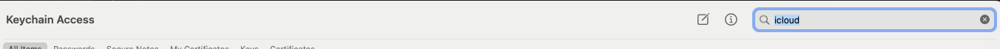
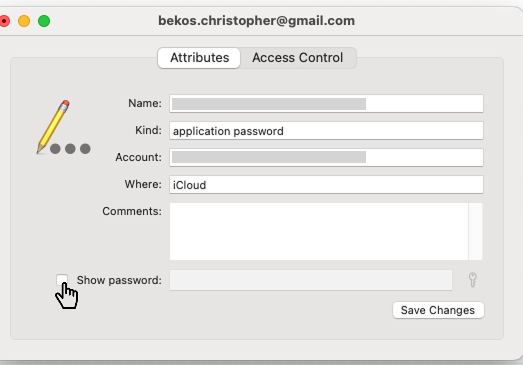

# AppleCollector

Query Apple's Find My network, based on all the hard work
of [OpenHaystack](https://github.com/seemoo-lab/openhaystack/), @vtky, @hatomist and others.

This is a fork of great work from @biemster and modified to have device locations sent to an endpoint.

## Prerequisites

- Install [uv](https://docs.astral.sh/uv/) (`brew install uv`) if you don't have it already.
- Install project dependencies: `uv sync`. Run commands with `uv run`, e.g. `uv run python manage.py refresh-credentials`.
- Run the tests: `uv run python -m unittest discover -s tests -t .`

### Project Setup (MacOS)

- Enable iCloud on your macOS device
- Search for `icloud` in the Keychain


- Select the `iCloud` entry with your email address


- Click on `show password` and copy the password


- Use this password as your `PASSWD` in the `.env` file


### Project Setup (non-MacOS)

You cannot use the `python manage.py refresh-credentials` command to refresh the credentials, since this require
access to the macOS keychain (and it's depended on hardware).

## Refresh Credentials

- Use the `python manage.py refresh-credentials --schedule-location-fetching` 
command to refresh the credentials (run on a MacOS, stored on AWS) and schedule location fetching (on AWS)


- Use the `python manage.py refresh-credentials` 
command to refresh the credentials (stored on AWS) without scheduling location fetching

> This command is handy for testing purposes

## Local Debug

- After you have executed `python manage.py refresh-credentials` you have one minute before the credentials expire
- Run `python manage.py fetch-locations --trackers E0D4FA128FA9,EC3987ECAA50,CDAA0CCF4128,EDDC7DA1A247,D173D540749D --limit 1000 --minutes_ago 15`
to fetch the locations of specific trackers

`fetch-locations` also has local-only flags, used by the control-center runner. None of them post anything to the API,
and `--send-reports` can't be combined with `--output json` or `--key-cache`.

- `--local-credentials` reads the Apple credentials from this Mac's Keychain (needs `PASSWD` in `.env`) instead of the
  shared record on AWS. It never writes credentials anywhere. On a 401 it reads the Keychain again.
- `--output json` prints one JSON document on stdout with every report in the time range per beam, plus the requested
  and missing trackers. Logs go to stderr.
- `--key-cache PATH` keeps the `GET /haystacks` device list (including private keys) in a local file, encrypted with a
  Fernet key stored in the Keychain (service `spaceinvader-control-center`, account `key-cache`, created on first use).
  The file is downloaded again when it's older than 24 h or a requested tracker isn't in it. `--refresh-keys` forces a
  download.
- `--minutes-ago` is capped at 10080 (7 days), about as long as Apple keeps reports.

```bash
uv run python manage.py fetch-locations --trackers E0D4FA128FA9 --minutes-ago 1440 --output json \
  --local-credentials --key-cache ~/.spaceinvader/key-cache.bin
```

## Deploy

The GitHub Action "Deploy Serverless App" deploys the Lambdas. serverless-python-requirements doesn't read `uv.lock`,
so the workflow exports it to `requirements.txt` first. To deploy from your machine, do the same:

```bash
uv export --frozen --no-dev --no-hashes --no-emit-project -o requirements.txt
npx sls deploy --stage prod
```

After changing dependencies, run `uv lock` and commit `uv.lock`.
